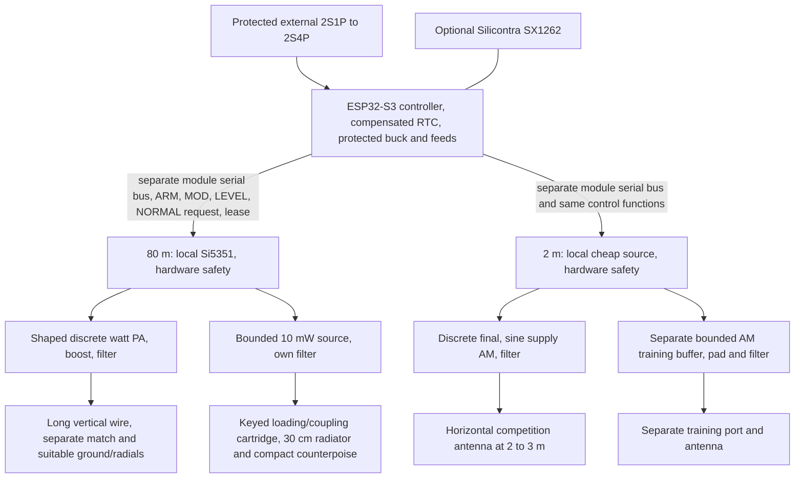

# M1 system architecture — cost rework

Date: **2026-10-13**. **Architectural baseline conditionally accepted; detailed circuits/layout are not released.** Accepted [ADR-0001](decisions/ADR-0001-modular-hardware.md) and the physically distinct HF antenna requirement remain. [Cost rework](M1_COST_REWORK.md) and [ADR-0007](decisions/ADR-0007-cost-optimized-m1.md) replace the earlier premium source/bridge proposal. No circuit, connector footprint or RF matching values are released.

## Functional topology

The controller owns stored validated profiles, time, slots, Morse identity/speeds, sine/PWM generation and setpoints. Wi-Fi/Bluetooth are off in contest operation. One ESP32 image supports absent RF boards and absent LoRa. Two RF configuration bridges are omitted. The RF boards own frequency generation, matching/filtering, shaped RF/envelopes, analog limits and persistent hardware inhibit. Independent testing uses an external host/fixture providing 3.3 V logic, protected 2S supply and the documented control signals; independent testing does not require a processor on every RF PCB.

HF first experiment: Si5351 plus single IRF610 class-C reference, adequate RF gate drive, approximately 15–16 V boost, shaping and filtering. QCX remains a comparison, not the automatic choice. Foxoring is a separate bounded source with its own port/network. VHF first cost experiment: local Si5351 plus filtered driver and PD55008 discrete final with BD140/op-amp sine supply modulation. ADF4002/discrete VCO is the lower-cost spectral fallback; LMX2571 is the higher-cost fallback. All adapted circuits are unverified. Frequency-source selection, AM headroom and placement comparisons are quantified in the cost rework.

## Exact electrical functions, not a connector footprint

Signals use 3.3 V logic; powered-off/backpower behavior, input protection and threshold tolerances must be established before schematic release. No unprotected logic pin accepts 2S or boosted voltage. Logic ground and RF power return have separately controlled physical paths joined to a defined reference, not galvanic isolation. Multiple return contacts may be necessary; pin-count minimization cannot override RF integrity or safe mating.

| Function | Direction / proposed semantics | Default / safety |
| --- | --- | --- |
| Protected BAT and power return | Controller → module, approximately 6–8.4 V operating design domain; cutoff determined by qualified pack | Fused branch and reverse/backfeed protection. High-current pair separate from logic harness. Both halves of its detachable connector are included in the wiring basket; M2 stress analysis provisions ≥5 A single-band or ≥7 A initial dual-band path rating, subject to measured inrush/efficiency. |
| VLOG3.3 and logic return | Controller → module, always-on safety/identity domain | External 3.3 V supply for independent test. Local POR rejects bad rail. |
| SCL and SDA | Controller ↔ module; separate bus per RF board, proposed ≤100 kHz initially | Si5351 fixed 0x60 does not collide across separate buses. Serial branch fault cannot hold RTC bus. Switched-source bus isolation prevents phantom power; input isolation defaults open. |
| ARM | Controller → module; enables one validated slot or explicit continuous-beacon service | Pull low; fresh rising edge accepted only with valid lease, rail, mode and no fault. Static high cannot restore a latched fault. Falling edge mutes immediately. |
| MOD | Controller → module | HF: logical CW key, with local rise/fall shaping. VHF: filtered PWM representing keyed sine around a defined carrier-centered value; centered no-tone code produces unmodulated carrier within the slot. Source-off is controlled by ARM, not by mistaking tone gaps for A1A. |
| LEVEL | Controller → module; filtered PWM analog setpoint | Local trimmer/clamp bounds maximum HF output or VHF carrier/envelope. Floating/invalid setpoint cannot request full power; rail/readback qualification before ARM. DAC unnecessary for base. |
| NORMAL_REQUEST | Controller → module | Low selects bounded branch only; high requests normal PA subject to cartridge/port hardware interlock. Change permitted only while ARM low, source/PA muted and energy discharged. Invalid identity/mode blocks both. |
| HEALTH_LEASE | Controller → both RF modules, separately buffered/protected branches | Edges issued only after fresh application/time/profile progress; nominal 20 Hz candidate, timeout 100–250 ms qualification target. Never a free-running PWM that survives a stuck task. Local monostable expires for stuck-high or stuck-low. |
| nFAULT | Module → controller, separately observed open-drain outputs | Active low for POR, timeout, current/temperature/rail trip or invalid mode. Missing/floating board cannot qualify ARM. Fault requires deliberate clear/rearm after the cause disappears. |
| MON/ID | Module → controller ADC, protected bounded analog voltage | Passive type-ID resistor while RF off; calibrated current/level monitor when active. Exact multiplex/clamp implementation OPEN and costed. Basic thermal trip/fault retained; detailed temperature/SWR telemetry optional. |
| Optional calibration EEPROM | On private module bus; type, serial, calibration and CRC | Optional automation. Base uses passive type ID, per-module manual trimmers/calibration record and printed serial; no unbound downloaded table may arm an unknown module. |

The nine logical signals are SCL/SDA/ARM/MOD/LEVEL/NORMAL_REQUEST/LEASE/nFAULT/MON, plus VLOG/ground and the independent power pair. Pin numbers, shield termination, return-contact count and connector mechanical family remain open. Optional EEPROM is not necessary for safe passive module detection or hardware-calibrated upper limits. A VHF ADF4002 alternative substitutes DATA/SCLK/LE for I2C and adds a lock-status function; recalculate pin contract rather than pretending two pins carry an undocumented SPI protocol.

Provisional S3 GPIO count: two RF serial buses 4; ARM/MOD/LEVEL/NORMAL 2×4=8; shared lease 1; independent faults 2; module analog monitors 2; separate RTC bus/interrupt 3; native USB 2; wired sync 1; button/LED 2; battery-voltage ADC 1; LoRa SPI/reset/BUSY/DIO1 and optional supply gate8 = **34 GPIO**. Optional pack-current input adds one. VHF PLL fallback adds serial/lock functions, using remaining capacity or documented multiplexing. GPIO availability/strapping, package variant, voltage domains and peripheral resources still need exact pin-map review. C3 cannot simply replace S3 on this contract to save €1.47.

## Local safety independent of application execution

Each board retains HC123-style retriggerable hardware lease, HC74 persistent latch, HC08 gating, MCP100-class POR and analog current/temperature/overvoltage trips. The part catalog includes RC/passive/gate/isolation functions; this is not a validated safety circuit. HC123 timeout and startup are tolerance-dependent. Cheap logic is acceptable only if qualification proves the same fail-off behavior.

RF must require ARM AND live lease AND valid rail/mode AND no latched fault. POR/undervoltage/fault dominates arming. Lease recovery alone must not rearm. The HF PA gate is constrained against static/missing RF drive; original ON7YD key-before-oscillator behavior cannot be copied unchanged. Planned AC gate coupling/bleed/clamp/drive-valid checks need bench proof.

Use separate source/drive hard mute and actual PA supply isolation. Converter EN or a modulator transistor alone is not true output-off, and a failed series modulator must not energize a bounded branch. Switched source power plus isolated SCL/SDA prevents I2C pullups keeping the oscillator alive. Bleeders discharge stored rail energy; source/PA leakage and near-field audibility must be measured. The architecture does not claim protection against every imaginable multiple-component failure.

Retune sequence: lower ARM/MOD; source/driver mute and PA isolation; confirm current/rail discharge; change mode/frequency while inhibited; verify register/status/frequency qualification and regulator settling; establish safe setpoint; deliberately rearm on a fresh edge. Abort on timeout or unexpected status. Fault/startup recovery returns to inhibited state, with time/profile validity required before restart.

## Antenna and output separation

No RF switch connects the watt output to the Foxoring or VHF training network. Normal and low-power bulkhead sockets are mechanically incompatible, with strain-relieved dedicated pigtails, explicit ground and cartridge/port identity. Connecting the compact HF cartridge inhibits normal PA in hardware. Its own filter/pad/clamped source bounds RF energy even if firmware requests normal output. RF coupling through shields/returns must be qualified; separate nets are not proof of 77 dB training isolation.

Long-wire and compact 30 cm HF loading/coupling are separate costed installations. Match/counterpoise/field acceptance follows the feasibility and validation documents. The Fox-only population omits the watt branch on the same 80 m PCB, retaining local safety, bounded source/filter and the compact cartridge. No fourth primary PCB is introduced.

## Timing, profiles and LoRa

Existing [rules trace](M1_REQUIREMENTS_TRACE.md) governs timing/frequency/power semantics. RTC holdover and cached validated schedule are autonomous; time corrections apply only between slots. Synchronized Sprint groups transmit concurrently on separate frequencies in corresponding 12 s slots; optional spectator and continuous finish/beacon roles have independent frequencies. Crystal/RTC accuracy is separate from firmware boundary accuracy. Cold battery swap without optional backup invalidates absolute time and prevents ARM until resynchronization; it does not relax contest timing.

LoRa reserves SPI SCK/MOSI/MISO/NSS, reset, BUSY, DIO1, protected supply/ground and any actual Silicontra-specific switch/TCXO controls. Exact module remains OPEN. Detection uses passive presence if available, bounded reset/BUSY/status and repeated non-transmitting command/readback tests; all-zero/all-one responses are not presence. No fictional chip-ID register. Missing radio has no effect on autonomous operation. RF/LoRa simultaneous noise, supply peaks, GPIO upset and local legal settings require tests.

## Cost and review boundary

Essential digital telemetry/provisioning functions remain without premium DACs/meters/local MCUs. Shared synthesis has been re-costed including board launches/filters/buffers and excluded-but-real coax wiring; gross source saving is about €1.79, not a decisive benefit. [Itemized materials](M1_COSTED_BOM.md) include protection/filter/thermal functions with explicit unknowns. The previous nine-pin MCU-bridge semantics, LMX-first selection and fixed coax penalty are superseded proposals. [ADR-0007](decisions/ADR-0007-cost-optimized-m1.md) records conditional acceptance. [M2 preparation](M2_PREPARATION.md) develops RF proposals and measured gates before complete layout/procurement. No product firmware or PCB layout was implemented.
