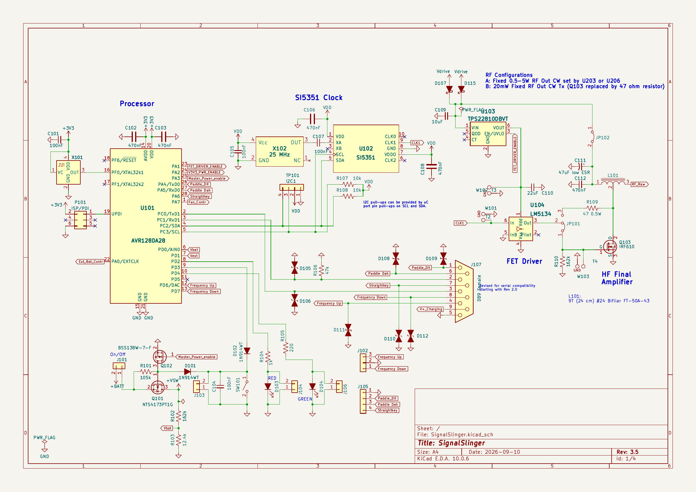
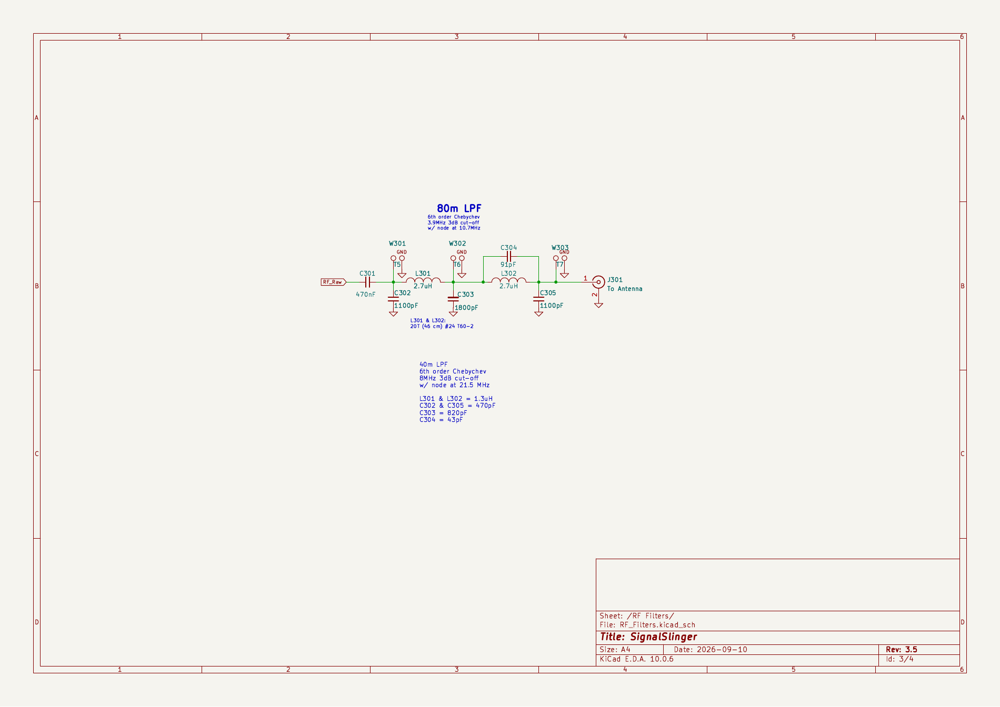
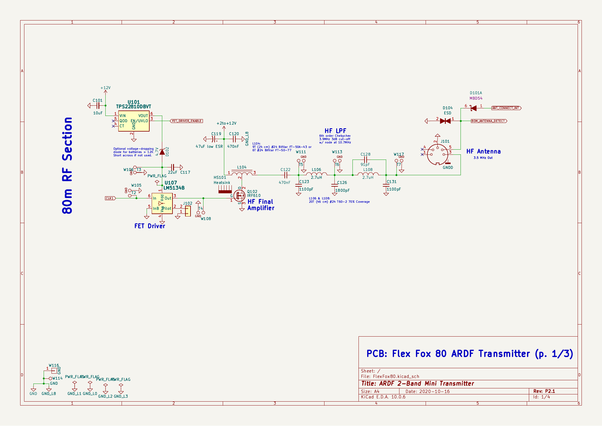

# Minimal derived 80 m RF topology proposal

Date: **2026-10-13**. **Reviewable circuit proposal, not a released schematic or validated transmitter.** Preserve the three primary PCBs, existing ESP32-S3/RTC controller, optional unpopulated Silicontra footprint, local synthesis and protected external 2S1P–4P. The 2 m architecture is unchanged. Exact reference variants and source limitations are in [the schematic comparison](M2_80M_REFERENCE_COMPARISON.md).

## Preferred normal-power circuit: SignalSlinger RF core

Use SignalSlinger's **Si5351 → LM5134B → IRF610 → bifilar transformer → original elliptic LPF**. Prefer approximately **1.2 W Classic**, **0.85 W Sprint**, with separately calibrated bounded settings. These are proposed targets, not published measurements. Keep higher-power population options open. Do not reuse SignalSlinger's shared-port MOSFET/resistor substitution for Foxoring.

The following are **unaltered upstream sheets**, rendered for inspection. They are not ARDF-TX design files. Their license/attribution is [included](assets/80m-reference/LICENSES.md).







### Annotated original connections, not a substitute block diagram

| Original nodes/components | Exact inspected electrical connection/value | Reuse / proposed change |
| --- | --- | --- |
| SignalSlinger U102/X102 | Si5351 pins 1/7=3.3 V, 8=ground, 4=SCL, 5=SDA, 9=CLK1;25 MHz TCXO coupled through C107 100 nF to XA/pin 2;XB/pin 3 unused. | Local source retained; controller supplies I²C. A low-cost 25/27 MHz **crystal uses XA/XB crystal mode**, not a copied TCXO footprint or the same AC-coupled input. Internal load capacitance must match exact crystal. Calibration/total temperature-aging error must pass 50 ppm; crystal price/MPN still OPEN. |
| U104 LM5134 | Pin 6 non-inverting IN=CLK1, pin 5 INB grounded in reference, pin 1 VDD=switched Vdrive, pin 4 VSS=ground;pin 3 OUT directly to Q103 gate. PILOT/pin 2 unused. | **B suffix required** for direct 3.3 V drive: VIH 2.4 V, VIL 0.8 V. A requires 0.67×VDD high, fails at 5.5 V and above. Adapt INB to independent hardware inhibit with default-high pull and qualified 3.3 V logic. Gate bleed/R110 = 164 kΩ reference; optional small gate stopper/clamp values require measurements. No invented AC coupling stage. |
| Q103/L101 | IRF610 gate 1=driver OUT;source 3=RF ground;drain 2=L101 center tap/pin 2. L101 pin 1=supply and pin 3=`RF_Raw`. | Retain 9-turn #24 **bifilar FT-50A-43** and tap/polarity. This transformer-fed stage differs from ON7YD's simple 5µH choke and must not inherit its power curve. Add source-current trip and supply isolation. |
| Native drain/driver supply | Common supply to driver and L101 in SignalSlinger. FlexFox80 instead powers driver 12 V and L104 from variable 2–12 V. | Economy: normal-only **TPS62160 buck** from 6.0–8.4 V, approximately 5.5 V upstream of shaper in Classic; bounded lower setting for Sprint. Its maximum output is 6 V/1 A; cannot supply 7.6/10.2 V. Driver stays at a fixed rail during each key envelope; shape **drain supply**, not source frequency. Worst 6 V headroom and lower-Sprint gate-drive sufficiency are NOT RUN. |
| C301/L301/C302 | `RF_Raw`→C301470nF series→node A; C3021100pF node A-ground; L3012.7µH node A-node B. | Preserve topology and start values, suitable genuine cores and voltage ratings. Block capacitor RF loss must be characterized. |
| C303/L302/C304/C305 | C3031800pF node B-ground; L3022.7µH node B-output; C30491pF **across L302**, C3051100pF output-ground. | Retain filter's transmission-zero branch. Both coils 20T #24 on T60-2. Author labels 3.9 MHz/third-harmonic node 10.7 MHz. This is not an ordinary five-pole Butterworth filter or proof of our emissions. Output is a defined 50Ω reference plane, followed by a separate long-wire tuner. |
| Original keying | Si5351 output-enable and TPS22810 driver-supply enable, software-managed. CT/QOD pins unused in inspected sheets. | Add measured CW shaping and local independent fail-off. TPS22810 CT controls startup rise; it does not by itself establish a soft falling RF edge or reverse isolation. Reference software “safe mode” is not autonomous hardware protection. |

[TI LM5134 datasheet](https://www.ti.com/lit/ds/symlink/lm5134.pdf) confirms 4–12.6 V operating supply, UVLO/power-off gate pull-down and input-threshold distinction. [TPS62160](https://www.ti.com/product/TPS62160) is manufacturer Active and supports the economy voltage range. IRF610 threshold voltage is not a guaranteed low-voltage on-resistance or efficiency specification. Only loaded waveform/power tests can establish the 5 V adaptation.

SignalSlinger documentation permits some external input configurations up to 13 V and warns about damage above 14 V. Those are not permission to exceed the LM5134 operating maximum: 14 V is its absolute maximum, while 12.6 V is the upper operating limit. Diode drops vary with current; our driver supply needs a measured bound including startup, temperature and overshoot.

### Proven low-component-count shaping instead of the old feedback shaper

Borrow the **QCX/W6JL integrator mechanism**, documented in [QCX manual §5.12](https://www.qrp-labs.com/images/qcx/assembly_A4-Rev-5e.pdf): PNP pass emitter to PA rail, collector to shaped drain supply; 150Ω emitter-base pull-up, 1.2k base-to-key-switch drain, 2.2µF collector-base integration; key-switch source to ground. The manual contains a 5 ms RF-envelope measurement. Its figure still labels MPS2907 while current BOM uses **MPS751**: follow the corrected BOM and exact-vendor data, not an old silhouette/pinout.

For ARDF-TX, candidate **Central MPS751 PBFREE** retains that principle; existing small FET performs key-switch function only after 3.3 V drive/pinout verification. **RC values are starting references, not copied guarantees** at 5.5 V or with this different PA. Bound shaper voltage/current and tune edges on the bench. For stress analysis only, assuming 55% drain-stage efficiency before the shaper at 5.3 V gives estimated 1.2 W drain current of 0.412 A; assuming 0.2 V pass drop gives 0.082 W steady pass dissipation. For a resistive load surrogate, peak pass dissipation is Vs × I_full / 4, approximately 0.57 W at 5.5 V and 0.412 A. That surrogate is not the switching PA's SOA trajectory; measure current/voltage during edges and mismatch. At 5 W/60%/10.2 V drain current is 0.817 A and a 12 V-edge resistive surrogate peaks 2.45 W, so TO-92 pulsed/hot-case SOA cannot be presumed. A qualified current PNP/heat sink substitute must be recosted if necessary.

The original RC values also fail a simple low-voltage base-current check if copied unchanged. Assuming 0.7 V base-emitter drop at a 5.5 V rail, the 1.2 kΩ key resistor sinks about 4.0 mA while the 150 Ω emitter-base resistor draws 4.7 mA. That does not establish the required 0.412 A collector current. For an initial forced-beta-20 calculation, about 21 mA base current is needed; a 1 kΩ emitter-base resistor and approximately 220 Ω key resistor are possible starting **calculations**, followed by complete edge/SOA measurements and RC retuning. The key resistor then dissipates about 0.105 W and needs an appropriately rated part, provisionally at least 0.25 W; higher rails can require a 1 W part. The generic resistor allowance is not a released package/rating or a verified price for that position. This is a necessary adaptation of a documented shaper, not evidence that its original 12 V values work at 5.5 V. Reprice exact resistors/pass-device changes before accepting the cost target.

RF drive starts only with drain supply inhibited. A normal key-up must allow measured shaper decay before removing RF drive; off-slot shutdown then disconnects source/driver/PA and discharges stored rails. Emergency/fault shutdown bypasses graceful shaping. This replaces the old HF D45H11/BD139/op-amp linear-envelope proposal; it does not revise the separate VHF AM modulator.

## Separate Foxoring branch on the same RF PCB

**Preferred mechanism to evaluate:** TinyFox's three paralleled 74HC00 output gates, driven from a separately enabled output of the **same local Si5351**. Fourth gate is spare/used only after logic review; no local crystal, ATtiny, RTC or AA boost. Keep the already budgeted bounded 3.3 V feed, input limiting/clamps, key/enable gates, own filter, calibration pad/detector and dissimilar compact socket. Normal PA/driver/buck or boost/large toroids/heat sink are **DNP** in Fox-only assemblies. High-power output copper never connects to the compact port.

Concrete candidate signal connections:

```text
Si5351 CLK2 -> current-limited clock input -> three HC00 gate inputs
Each other NAND input <- Fox key/permit (defined pull-down)
Three gate outputs tied as in TinyFox -> RF DC block
-> separate low-power copy of two-inductor LPF -> fixed calibrated pad
-> 50-ohm FOX reference connector -> independent compact antenna cartridge

Independent bounded rail -> HC00 supply; local decoupling and discharge
Fox RF detector/current/rail limits -> persistent fault latch
Compact plug identity/contact -> hardware normal-PA inhibit
```

This specifies the **original buffer mechanism and new integration boundary**; no nominal 10 mW or shaped-key claim is made from gate count. At 3.3 V an ideal unipolar square wave has fundamental 44.1 mW into 50Ω with zero source resistance. Real gate impedance, parallel current sharing and LPF/pad loss reduce that. A 4–6 dB pad might reach 10 mW, but can also leave insufficient drive. Measure first; do not arbitrarily increase gate voltage or connect watt output to recover it. Existing two-small-BJT/feedback-buffer population remains a costed fallback if the logic branch fails.

**Fox key shaping is still OPEN.** TinyFox's direct gate keying does not document our 3–8 ms envelope target. Trying to ramp its supply while injecting 3.3 V clocks can backpower HC00 through input clamps. Any borrowed low-current integrator must include input-energy limiting, discharge and source gating, and pass off-slot/edge tests; the current guard provision is retained. The tentative op-amp/trimmer removals in the economy ledger are **conditional savings, not released deletions**. Restore necessary parts if gates fail; prefer a proven buffer over a new elaborate control loop. No lifetime or low-current claim is transferred from TinyFox/Fixle.

A 20 mA rail limit at 3.6 V bounds DC input to 72 mW; a 1k input resistor can add up to 12.96 mW in a conservative drive-energy bound. With 4 dB attenuation this is **33.8 mW**, not 10 mW. That is a calculation demonstrating why a rail limit alone does not prove the nominal power limit. Preserve detector trip/guard, calibration, stored-energy and backfeed measurements. Under faults the stage must mute; its compact network must tolerate the bounded transient. It must never receive normal PA power. Retain 47 dB main-to-Fox isolation target for the optional 5 W population, even when the first PA is smaller.

### Independent antenna circuits

**Long wire:** post-LPF 50 Ω source→separate adjustable series loading/L-match accessory→long vertical plus defined return; use DF1FO variometer/current indication or G3ZOI L-match principles after impedance measurement. A 68 pF series+100Ω reference emulator is useful for comparison to DF1FO, but never substitutes for the 50Ω source-power test. Keep symmetric Sprint counterpoise; 8m+6m is an example, not a mandated geometry. Matching loss, coil current and capacitor voltage at 1.2 W and higher must be measured separately from PA performance.

**Compact:** calibrated 10 mW / 50 Ω plane→dedicated coupling/loading network→approximately 30cm radiator and defined compact counterpoise. TinyFox's 100µH+antenna-side 1.6–15pF network is a concrete starting reference; do not blindly install 100µH in a different 50Ω geometry. Measure effective capacitance/return/case/pack first. At 3.55 MHz, total 5–15pF needs roughly 402–134µH for simple series resonance. For 10pF/Q50, inductance 201µH and coil-loss≈89.7Ω give about 47Vrms reactive voltage at 10 mW if that loss dominates. Installation, body proximity, wet vegetation and pack leads change capacitance and field pattern. Separate transformer/tap coupling may be needed to match 50Ω; that work remains explicit new adaptation. Nominal power stays 10 mW; tune coupling/loss/return for field reach, not the PA power label. Existing€8.38 cartridge budget is retained, including coil, capacitors, protected connector, radiator and return.

## Interface and proportionate fail-off

Interface electrical levels are controller-domain 3.3 V. SCL/SDA are open-drain with pulls on the switched source side and fail-open bus isolation. Control inputs have local default-off pulls; FAULT is an open-drain output with a controller-side pull. The driver INB default-high pull should remain effective from its own driver rail; a qualified open-drain transistor can pull it low without feeding that rail into an ESP32 pin. Separate raw-2S and signal returns keep PA current out of the logic reference. Default levels, POR/rearm behavior and supply sequencing must be tested with the controller disconnected.

Minimum logical functions: **I²C SCL/SDA; MODULE_ENABLE/ARM; CW_KEY; POWER_MODE; application-progress LEASE; active-low FAULT**. Seven signal conductors plus 3.3 V and at least two returns are a 10-contact logical allowance; raw 2S travels through its separate protected power pair. Passive module ID is optional/separate or multiplexed while inhibited. Higher-power continuously adjustable level, if chosen, needs one additional bounded filtered-PWM function, not another MCU/DAC. Exact footprint/pin numbering remains OPEN.

Onboard compact-contact interlock must not consume a firmware-dependent control function. Retain **one retriggerable lease, one persistent latch, one POR and gating**, comparator channels for rail/current/temperature/RF trips, real rail-disconnect devices and bus isolation. These are distinct purposes, not duplicate software watchdogs. Both halves of a dual timer/latch can serve related functions; do not multiply supervisors by branch. Controller battery protection and RF lease/trip protection cover different failure domains. High-side switch body diodes/converter EN alone cannot replace PA isolation.

Define default-off pulls at connector, local qualified rearm after a fresh ARM transition, heartbeat timeout≤250 ms, direct inhibit≤1 ms and a PA over current trip initially≤100µs subject to exact SOA. A stuck-high drive/frequency-source fault must be survived by analog trip, not a 250 ms firmware lease. During configuration/retuning keep drain cutoff and driver INB asserted, source outputs disabled until settings are verified; permit source configuration only in a bounded lease interval. Clock/DUT radiation during that interval must pass the silence gate. Independent testing uses a shared external host fixture and bench supply.

## Retained higher-power alternative

The same IRF610/transformer/filter core remains the 2–3 W/5 W alternative. Flex's independently supplied drain provides a concrete adjustable reference. A 2S-compatible **boost→LTC3600 variable buck** candidate avoids assuming that a boost can lower 8.4 V to 6.3/7.6 V. Use about 11.5–12 V upstream with proven clamp/overshoot margin below LM5134's 12.6 V limit; exact set points/compensation/OPA171 interface are OPEN. Normal PA shaper/interlocks remain.5 W post-filter at 10.2 V is a publisher typical value, not guaranteed headroom.

This alternative adds approximately€11.10 at ten compared with the economy module, chiefly the€6.13 buck, second converter and support/thermal parts. A cheaper boost+linear option and the old M2 discrete shaping proposal remain comparative fallbacks, not selected validated designs. Low-cost converter ICs do not establish equal noise, efficiency or cutoff. Review [ADR-0010](decisions/ADR-0010-proven-80m-core-and-power-target.md) before choosing a power population or proceeding beyond paper/fixture planning.
