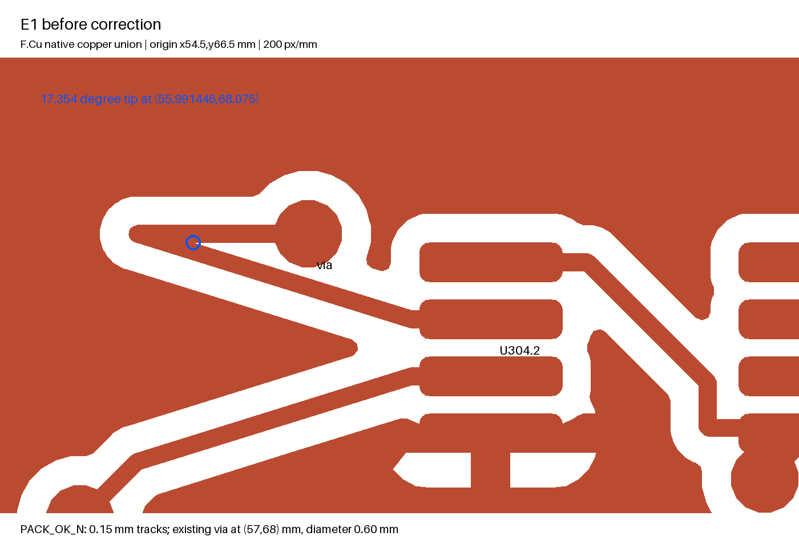
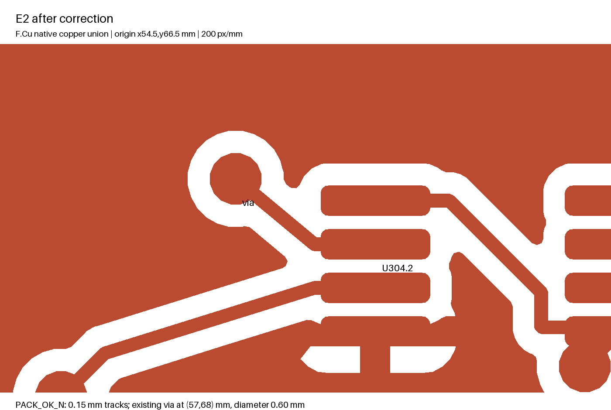

# M5B-E2 copper correction

2026-10-16. Baseline: `m5b-e1`, commit `6931260`. No hardware was built or powered.

The original coordinate-less F.Cu warning is conclusively located at **(55.991446, 68.075) mm on PACK_OK_N**, beside U304.2. Two 0.15 mm control tracks doubled back over each other and created a **17.354° acute copper tip**. This is an overlapping signal-track protrusion, not an isolated ground wedge or evidence of a short.

| Item UUID | E1 | E2 |
| --- | --- | --- |
| `62c24e8d-cdd2-46ed-a062-f5dba1cb82c0` | (57.9,68.75) → (55.5,68) | Ends at existing via (57,68); remains 0.15 mm wide |
| `deabdd94-a712-440c-b152-694a92481f7e` | (55.5,68) → (57,68) | Removed |

The union tip lies between adjacent polygon vertices (56.712587,68.075) and (57.911445,68.675) mm. Its width tapers toward zero even though both original tracks were nominally 0.15 mm. The redundant 4.014 mm route becomes a direct 1.172 mm connection to the unchanged 0.60/0.30 mm via. The correction removes an unnecessary etching/reliability risk. Native clearance checking remains at 0.15 mm. A native polygon-distance calculation gives approximately **0.2505 mm minimum other-net copper clearance** along the corrected finite-width track (`copper-clearance.json`). This is a CAD measurement with curve approximation, not an etched-board measurement.

These images render native copper polygons used by the detector; drill apertures are not subtracted in that representation. The separate drill files and fresh copper previews remain the manufacturing references.

[The reproducible locator](../tools/m5b_e2_sliver.py) adapts the [KiCad 10.0.6 sliver algorithm](https://github.com/KiCad/kicad-source-mirror/blob/10.0.6/pcbnew/drc/drc_test_provider_sliver_checker.cpp), with its default 20° angle, 0.08 mm base and 0.0008 mm skipped-edge thresholds. It finds exactly one E1 candidate and none in E2. This geometric reproduction supports localization; native KiCad DRC remains authoritative. The script retains the upstream GPL notice. Source revision and SHA-256 are recorded in the E2 source log.

The regenerated comparison Gerbers contain the original two 0.15 mm draw commands and the revised single draw. The acute tip results from overlapping draws; it is not an explicit vertex record in the Gerber. [copper-investigation.json](../hardware/2m/review/M5B-E2/copper-investigation.json) records commands and the native/Gerber assertions. Analysis copies in `copper-investigation/` are comparison evidence, never order files.

| Controlled native check | Result |
| --- | --- |
| Exact E1 board and rules | 12 warnings, including one sliver |
| Only the two-track correction, original rules | 11 courtyard warnings; no sliver |
| Same correction, connection-width threshold activated at 0.15 mm | Five additional connection findings |
| Final E2, active 0.15 mm threshold | 11 courtyard warnings; no sliver or narrow connection |

The rule audit exposed a separate coverage gap: E1 had `min_connection=0`. The following localized corrections clear the five newly visible findings without suppressing them:

| Finding | Native geometry / correction |
| --- | --- |
| V3V3, approximately (175.1893,140.8794), 0.0057 mm contact | Add a 0.30 mm junction link from (174.9,140.8) to (175.5,141.1), strengthening a redundant via/pad contact beside R704. |
| TRAIN_COMMAND, approximately (128.2500,82.5500), 0.0505 mm | Replace four staircase segments with one 0.20 mm diagonal from (128.4,82.7) to (128.1,82.4). |
| V3V3, approximately (63.8267,64.3786), 0.1352 mm | Widen only the 0.10 mm segment (63.7,64.4) → (63.8,64.4) to 0.20 mm. |
| U201.5 V3V3 approach, 0.0514 mm | Shorten the main approach to (57.45,35.975), removing three redundant branches around the unchanged power via. The DRC pad-center coordinate is not claimed to be the neck centroid. |
| GND fill, approximately (128.2026,127.0871), 0.0036 mm | Add a fill-only keepout x128.0–128.4 / y126.9–127.3 mm. It does not prohibit tracks, vias or pads. |

The first, second, third and fifth locations were obtained by polygon triage and checked through native correction/refill/DRC. The complete original warning records are in `connection-width-before.json`. Exact added, removed and modified item IDs are in [layout-delta.json](../hardware/2m/review/M5B-E2/layout-delta.json): four modified tracks, seven removed tracks, one added track and one new fill-only keepout, relative to E1.

The GND notch is outside the RF and source-thermal regions. Existing ground stitching and the bottom return plane remain. No footprint, via, RF line, matching value, source thermal contact or connector moved. Native isolated-copper, starved-thermal and unrouted checks pass. These corrections change no schematic net, component or population rule.
