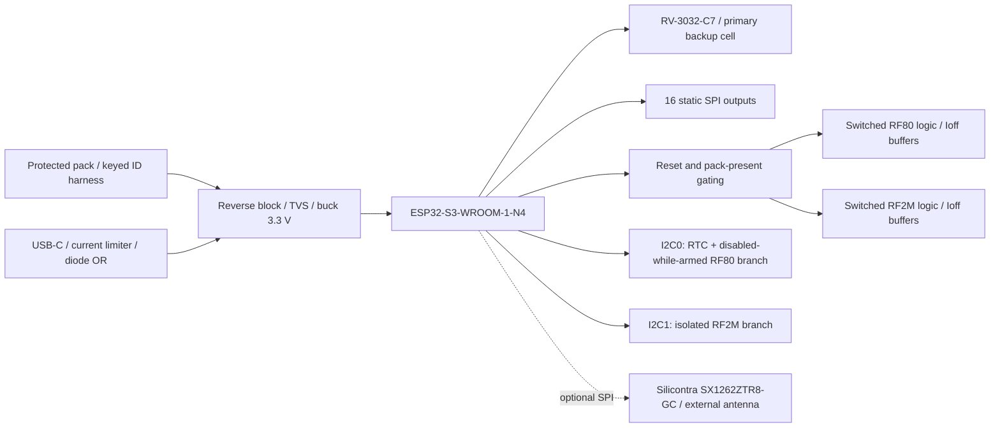

# M6-C1 — common controller engineering candidate

The controller is one editable KiCad 10 project, [CTRL](../hardware/controller/CTRL.kicad_pro), for the existing three-PCB family. RF80-V1 and RF2M-E4R1 are unchanged. They remain physically unqualified RF candidates. No M6 acceptance tag or manufacturing release is implied.

ESP32-S3-WROOM-1-N4 provides 4 MB flash, native USB and 36 available GPIO without PSRAM pin conflicts; three remain reserved straps. The manufacturer module includes its oscillator, flash, RF matching and antenna. A bare S3 would require those circuits, fine-pitch assembly and separate RF verification; no small-series saving has been established. N4R8/octet-PSRAM substitutions are prohibited: GPIO35–37 are used here. N8 without PSRAM is only a potential separately checked substitution.

The complete [GPIO allocation](../hardware/controller/review/M6-C1/GPIO-allocation.json) is binding. GPIO0 is BOOT only; GPIO3/45/46 remain unused straps. GPIO19/20 are USB, GPIO43/44 recovery UART. ARM, mute release, progress, key, slot and both PWM channels use direct GPIO. Two SPI 74HC595s carry static requests, profiles, branch power and bus permissions. They share clock/data with optional LoRa but have a separate latch. A mutex-protected transaction raises LoRa NSS, sends the complete 16-bit control word and pulses RCLK. LoRa traffic may change the shift register but cannot change its storage latch. SRCLR does **not** clear the output latch; the safe boot sequence explicitly latches zero before INIT_OK.

No RF-side MCU, additional scheduler, display, charger or GPS is introduced. Each RF board retains its own autonomous failure shutdown. The controller adds reset/default-state isolation and selects only one control-output bank. A new controller watchdog duplicating both RF watchdogs is unnecessary: genuine application progress drives their existing timers. The internal ESP watchdog remains useful but is not the independent RF safety mechanism.

FOX_MIN omits ten normal-PA control positions; RF80_FULL retains them. Both retain RTC and hardware-isolated Fox control. Their RF-board populations also differ. RF2M_FULL omits the RF80 port electronics. UNIVERSAL fits both; LoRa is a separate optional, currently held population. The 100 × 100 mm layout preserves ESP antenna clearance, separated cable headers, USB access and ordinary assembly. A second Fox controller PCB would save only an unquoted small bare-board area allowance while duplicating design and provisioning; it is not implemented.

The exact Silicontra manufacturer document describes **SX1262ZTR8-GC**, 15 × 15 mm, 862–960 MHz. The available distributor listing says **SX1262TR8-GC**. Equivalence has not been established. The optional footprint records nominal manufacturer dimensions but its tolerance/ambiguous end-offset callout requires a sample/drawing check. Leave the entire LoRa option DNP until resolved. Autonomous RTC operation has no dependency on it.

Accepted ADR status is unchanged. ADR-0001 is accepted for architecture feasibility; ADR-0003/0005/0007 are conditional architectural decisions; ADR-0011 remains proposed. M6 implements the user's current battery-backed-RTC and dual-voltage instructions without silently approving earlier proposed electrical designs.

Sources: [Espressif module datasheet](https://www.espressif.com/sites/default/files/documentation/esp32-s3-wroom-1_wroom-1u_datasheet_en.pdf), [layout guidance](https://docs.espressif.com/projects/esp-hardware-design-guidelines/en/latest/esp32s3/pcb-layout-design.html), [Silicontra V1.0](https://www.silicontra.com/UploadFile/Soft/SX1262ZTR8-GC%28V1.0%29.pdf). Retrieval: 2026-10-18.

The common PCB has 100 cm² area. FOX_MIN omits the RF2M and LoRa populations and ten PA-only control positions; its 140 fitted parts cost about €18.71 at quantity ten versus €22.06/185 parts for UNIVERSAL. The €3.35 component saving and unchanged base supply/RTC/MCU show why a separate reduced controller is not justified here. The universal board still imposes a 100 × 100 mm mechanical footprint on Fox-only units; integration into the final compact enclosure remains unqualified. DNP pads add no designed powered load. Host awake/sleep current must be measured; no low-power claim is inferred from omitted parts.

The bare-IC alternative would add external SPI flash, a40 MHz crystal/load network, ESP RF matching/antenna implementation and finer QFN assembly. None is removed from the RF modules by that choice. An unquoted planning comparison of €2.80 S3 IC plus €1.30–2.00 external parts is €4.10–4.80 before additional RF/assembly work, compared with the observed €3.88 WROOM N4 at10. Those bare-part figures are estimates, not supplier observations. The certified module is therefore selected for sourcing and assembly simplicity; no claimed bare-IC saving supports taking its extra risk.
