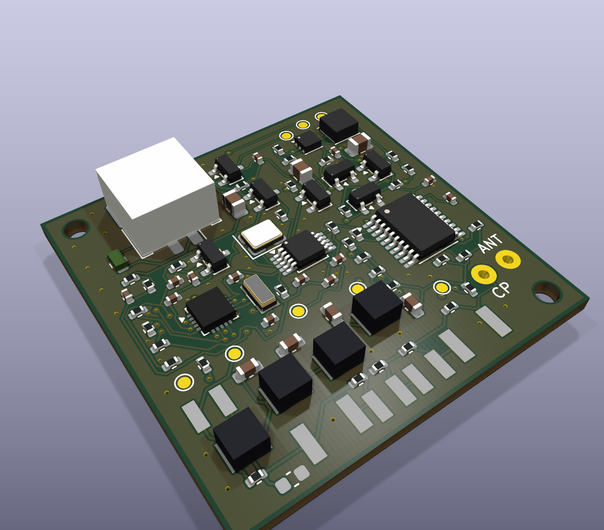

# Mini80-SMD — M80-E1 engineering candidate

**35 × 35 mm, autonomous, two-layer 80 m transmitter. GO for five unpopulated evaluation PCBs. HOLD for a populated fleet or any competition claim pending the first-article measurements.** Nothing has been ordered, programmed or energized. This independent fourth family does not change RF80 M4A-V1R1, RF2M M5B-E6R2, Controller M6-L2 or their manufacturing packages.

Open [Mini80.kicad_pro](Mini80.kicad_pro) in **KiCad 10**. The [native schematic](Mini80.kicad_sch), four subsidiary sheets, [fully routed PCB](Mini80.kicad_pcb), project symbols and custom footprints are editable CAD. The [schematic PDF](review/Mini80-schematic.pdf) and [assembly drawing](assembly/Mini80-top-assembly.pdf) support independent review.



The render shows the optional component locations as mechanical envelopes. The bench BOM leaves the loading coils and C30 unpopulated. AVR, connector and Coilcraft bodies use original simplified envelope models; these images are not photographs or detailed vendor CAD. See [top](render/Mini80-top.png) and [bottom](render/Mini80-bottom.png) views.

## Classification and scope

**MINI50 is informal Sprint/training equipment.** Its approximately 50 mW target is below the official Sprint 0.3–1 W requirement. **FOX10 is an uncalibrated Foxoring candidate:** target 10 mW conducted output at a defined 50 Ω reference port; antenna selection and field verification remain essential. Field audibility must include 30 m and exclude 250 m. A normal-power Foxoring finish transmitter requires separate hardware; use the existing RF80 family where appropriate.

The [IARU Region 1 Part B rules, 2025](https://www.iaru-r1.org/wp-content/uploads/2025/01/ARDF-Rules_B_2025.pdf) specify 3.510–3.600 MHz, frequency stability better than 50 ppm, Sprint spacing of at least 20 kHz, five successive 12-second slots and continuous S/MO beacons. Foxoring uses continuous identifiers at 8–15 WPM, 10 mW field transmitters, a 1–5 W finish beacon and at least 30 kHz separation from it. Relevant sections: S6, T2.6, FT2.6 and F27.3. These are equipment classifications, not permission to radiate; no regulatory or field compliance has been demonstrated.

## Architecture selection

| Candidate | Assessment |
|---|---|
| A: modern AVR + 74HC240 crystal oscillator/parallel stage | Lowest likely parts count and standby complexity. Four simultaneously deployed frequencies require four obtainable, appropriately specified carrier crystals and oscillator qualification. Exact small SMD crystals at the desired frequencies were not established as a practical low-volume basket. No historical price is treated as a quotation. Retain this simpler fallback if B's RF tests fail. |
| **B: ATtiny1616 + Si5351A + 74HCT240** | Selected. One board/image supports every frequency and role. The synthesizer plus 25 MHz crystal adds approximately $2.0–2.7 in observed parts prices, plus switching/decoupling and clock-on current. This is reasonable for twelve independently configurable training units. No high-power MOSFET PA is added. |

The ATtiny1616 3 × 3 mm QFN has enough pins for the timing crystal, separate RF safety controls, battery/rail measurements, UPDI and fixture UART. A smaller AVR would trade away interfaces or require multiplexing. **74HCT240PW,118 TSSOP20** replaces the initially considered BQ package: its cut-tape price/stock and assembly access were better. The PCB still meets the size objective. All eight outputs have separate ballast resistors; they are never connected directly together.

Main parts and sourcing observations accessed 2026-10-21:

| Reference | Exact part | Function / low-volume source |
|---|---|---|
| U3 | ATTINY1616-MNR | Autonomous controller; Mouser, MOQ 1 |
| U4 | SI5351A-B-GT | Blank MSOP10 programmable source; DigiKey, MOQ 1. Do not substitute a preprogrammed `-Bxxxxx` SKU. |
| U5 | 74HCT240PW,118 | TTL-input RF driver; Mouser, MOQ 1 |
| U2 | TPS61099DRVR | Switched boost with true disconnect; LCSC C2842395 |
| U1 | MCP1700T-3002E/TT | Always-on 3.0 V LDO; LCSC C62244 |
| Y1 | ABS07-32.768KHZ-T | 12.5 pF timing crystal; Mouser |
| Y2 | CX3225FB25000F0FZZH1 | 25 MHz, 10 pF carrier reference; Mouser |
| L20–23 | Coilcraft 1008LS-102/332XJRC | RF filter coils; Mouser/direct |
| L31, L34 | Coilcraft 1812LS-333/153XJRC | Optional antenna loading; larger packages justified by loss/SRF |

See [sourcing and costs](SOURCING.md), exact [MINI50 BOM](assembly/MINI50-bench-BOM.csv), [FOX10 BOM](assembly/FOX10-bench-BOM.csv) and [initial wire-antenna BOM](assembly/MINI50-wire-initial-BOM.csv). Catalog observations are not reserved stock. Long-tail passive prices remain explicit allowances, so this is not a fully quoted procurement release.

## Supply, safety and mechanics

A **protected 1S Li-ion/LiPo cell**, externally charged, supplies J1 pin 1 positive / pin 2 ground. The PH2 battery plug is keyed; harness polarity must be checked because commercial packs differ. F1 is a 200 mA PPTC, Q1 provides reversed-battery blocking. Neither substitutes for cell protection. The software stops below 3.2 V and requires at least 3.4 V to re-arm. Configure the AVR BOD to 2.9 V. The converter's own low-voltage limit is not suitable cell protection.

MCP1700 makes 3.0 V logic. The boost feedback 390 kΩ/100 kΩ gives about 4.9 V in PWM and 5.05 V in PFM; a 4.6–5.35 V firmware rail window catches major faults. Both BOOST_EN and the switched clock supply default off in hardware. TPS61099 true output disconnect avoids an always-live battery-through-inductor RF supply. Preparation allows 12 ms for boost, 10 ms for clock supply, then bounded oscillator/PLL settling. These delays require measurement.

The Si5351 output high level is compatible with HCT's 2 V TTL threshold at its nominal powered rail. A shared 1 kΩ clock resistor limits input clamp current while the HCT supply is off. Its RC delay with eight inputs can distort duty cycle and must be checked. Q6 controls both output enables; retuning inhibits RF and removes VPA first. R21 pulls OE_N to **VPA**, avoiding a separate-rail backfeed path. RF, envelope, clock and boost controls all start low.

Q4/Q5 provide a supply envelope using 100 kΩ/100 kΩ and 47 nF: nominal gate time constants 2.35/4.7 ms. The firmware permits a 15.625 ms decay tail before inhibiting the clock. RF amplitude follows the actual transistor/load behavior; operation below the HCT guaranteed supply range during transitions needs testing. Immediate fault shutdown takes priority over a smooth tail.

The outline is **35 × 35 mm**, FR4, 1.6 mm, two layers, 1 oz copper. No impedance-controlled stackup. Two 2.2 mm NPTH holes at relative (2.5,2.5) and (32.5,32.5) accept M2 nylon hardware. Keep metal fixings away from the antenna network. Allow at least a 37 × 37 mm housing cavity and approximately 8 mm board/connector height, plus plug insertion, strain relief and battery space. J1's approximately 4.8 mm body is the tallest populated bench part; optional 1812 inductors are approximately 3.6 mm high. Actual cell and enclosure envelopes must be checked before selection.

Battery capacities below refer to protected packs; 150–300 mAh suits the slotted foxes, 560 mAh or larger suits S, and approximately 750–1,200 mAh suits a twelve-hour MO beacon. A 1,200–1,500 mAh pack is the calculated 24-hour FOX10 candidate. Battery and enclosure are outside the board dimensions and BOM prices. No charger is fitted.

## RF output and matching

```text
Si5351 CLK0 -> 1k -> eight HCT inputs
  eight inverted outputs -> eight individual 100R / 560R -> sum
  -> 10n C0G DC block
  -> 1u -- 3.3u -- 3.3u -- 1u -> TP7 RF50
          |        |        |
        1200p    1000p     820p
          GND      GND      GND
  -> optional series 2.2u / shunt 470p transformer
  -> selectable 33u + 10u + 4.7u + 15u loading -> ANT
CP is the RF ground/counterpoise connection.
```

The shunt capacitors follow the first, second and third series coils respectively. The diagram's columns are illustrative; use the native schematic/netlist for wiring.

**First-article bench populations:** L30–34 and C30 DNP; R50–54 fitted 0 Ω. Use a noninductive 50 Ω dummy load between ANT and CP, or a de-embedded fixture at TP7. Never attach a dummy load and antenna together. TP7 defines the conducted-power calibration plane before antenna matching.

**Wire training:** start with 6–9 m wire and a defined counterpoise (for example four approximately 2 m radials). The `MINI50-wire-initial` population fits L30/C30 and L31/L33, removing R50/R51/R53. This is a starting point for a modeled 100 Ω + series 50 pF load, not an assertion about every wire. The original 100 Ω + 33 pF artificial antenna requires about 60 µH: fitting all four loading coils gives 62.7 µH before the transformer. Tune/select values by measured impedance and delivered power; do not bridge a coil that is fitted.

**Foxoring:** start around 30 cm vertical, with its own documented counterpoise/installation. Bypass the long-wire loading bank. A selected coupling capacitor may replace R54; that value is deliberately **TUNE / NOT RELEASED** until the real antenna/field test determines it. The small antenna is strongly reactive; the 33–63 µH bank cannot optimally match a few-pF short antenna. Calibrate the board into 50 Ω separately, then select the antenna/coupling for the field limits. Ten milliwatts into a matched dummy load does not establish actual radiated field strength.

[RF/energy calculations](analysis/electrical-estimates.json) and [reproducible analysis](tools/analyze.py) use manufacturer coil models, explicit source resistance and 2,000 seeded tolerance trials. At 3.55 MHz, 4.95 V and assumed 30 Ω effective HCT output resistance per gate:

| Quantity | MINI50 (8 × 100 Ω) | FOX10 (8 × 560 Ω) |
|---|---:|---:|
| Predicted conducted power, 50 Ω | 47.4 mW | 10.16 mW |
| Fundamental RMS current per output | 5.74 mA | 2.66 mA |
| Ballast loss, all eight | 26.4 mW | 31.7 mW |
| Assumed driver conduction loss | 7.9 mW | 1.7 mW |
| Modeled LPF loss | 15.9 mW | 3.4 mW |
| Conservative keyed VPA budget, including bleed/dynamic overhead | 148.5 mW | 99 mW |

The 50 Ω filter S21 is −1.68 dB at carrier, −28.4 dB at second harmonic and −55.1 dB at third. Including the actual assumed low source impedance, an ideal square-wave model gives about −64.9 dBc third harmonic; a 45–55% duty assumption gives about −41.2 dBc second harmonic. These optimistic lumped-model results exclude coupling, converter noise, Si5351 spurs and real HCT transitions. They are **not spectrum-analyzer results**. MINI50 sensitivity spans approximately 36–60 mW for the stated tolerances/assumptions; power requires resistor selection after measurement.

HCT RF efficiency is not established by its digital current rating. The ballast-only bound for four outputs switching against four others is approximately **105 mA** at 5.2 V, above the 70 mA DC package rating. The datasheet does not guarantee output skew or this transient use. The expected fundamental currents do not resolve that issue. Measure switching current, loaded waveform, temperature and harmonics on the first article; obtain manufacturer clarification or revise the stage before a populated fleet release. If B cannot meet those tests economically, return to the faithful crystal/HC minimum-part-count option.

For coil Q, SRF, rating and voltage limitations see [RF component review](RF_COMPONENTS.md). Do not substitute generic 0402 chokes for the RF coils.

## Calculated endurance

The budget assumes 3.7 V average cell voltage, 80% usable labeled capacity, 85% boost efficiency, 22 mA clock-on logic, 0.2 mA always-on overhead and keyed VPA current of 30/20 mA. Prepared clock duty for slotted foxes is conservatively 20.84%; Morse duty is bounded by the chosen identifier. The LDO draws input current rather than converting logic power at 85% efficiency.

| Use | Assumed average battery current | Example useful runtime |
|---|---:|---:|
| Slow/fast MINI50 | 9.70 mA | 150 mAh: 12.4 h; 300 mAh: 24.7 h |
| S MINI50 | 34.0 mA | 560 mAh: 13.2 h |
| MO MINI50 | 47.5 mA | 750 mAh: 12.6 h; 1,200 mAh: 20.2 h |
| Continuous FOX10 | 37.9 mA | 1,200 mAh: 25.3 h; 1,500 mAh: 31.6 h |

These are calculated candidates. Quiescent rail components contribute only a few µA when disabled, but RTC wakeups, ADC sampling, Si5351 consumption, RF losses, cell resistance, temperature and cutoff capacity require measured integration. At 10 mW the synthesizer dominates: do not promise a tiny-cell 24-hour Foxoring unit.

## Universal firmware and twelve roles

The [firmware project](firmware/README.md) builds one AVR image. Per-unit 45-byte CRC-protected settings select frequencies, role, Morse ID, 8–15 WPM, physical power population, start delay, run duration and calibration. EEPROM does not retain an armed state. Reset, invalid settings, low battery or failed synthesizer communication inhibit RF. No main controller is needed.

| Role | Identifier | Default frequency | Slot in each minute | Default WPM |
|---|---|---:|---|---:|
| 0–4 slow | MOE, MOI, MOS, MOH, MO5 | 3.530 MHz | 0–12, 12–24, 24–36, 36–48, 48–60 s | 10 |
| 5–9 fast | MOE, MOI, MOS, MOH, MO5 | 3.570 MHz | same five slots | 15 |
| 10 spectator | S | 3.550 MHz | continuous repeated ID | 10 |
| 11 training finish | MO | 3.600 MHz | continuous repeated ID | 10 |

The four frequencies are independent settings within 3.510–3.600 MHz. Sprint validation requires at least 20 kHz separation. FOXORING mode uses FOX10 profile, a field role/identifier and at least 30 kHz separation from the configured external finish frequency. Continuous field operation has scheduled start/stop. Profile selection records the required resistor population; software cannot change fitted resistors.

The RTC runs at 128 Hz from Y1. Each nominal 12-second Sprint slot has one-second edge guards and only complete identifiers; clock preparation precedes the slot by about 500 ms. The guards tolerate opposite residual ±20 ppm errors over twelve hours, including the tested two-tick RF tail. **That residual bound must include load, temperature and calibration error.** Otherwise shorten sessions and resynchronize. Carrier and timebase have separate calibration settings. A shared 3 V fixture SYNC edge starts the epoch after each device is configured and explicitly armed. No 3.601 MHz example is used.

## Verification, outputs and decision

[Verification JSON](review/verification.json), [ERC](review/erc.json), [DRC](review/drc.json), [independent pin review](review/pinout-review.csv) and [firmware build/test log](review/firmware/build-and-test.log) are the evidence. The [portable review archive](review/Mini80-M80-E1-review.zip) and [deliverable index](review/deliverable-index.csv) collect all seventeen requested items. Native checks include schematic parity, 229 connected-pin comparisons and 85 manufacturer-pin comparisons. Firmware host tests cover twelve roles, no overlapping keyed slots, twelve-hour drift guards, complete Morse IDs at 8–15 WPM, CRC bit faults, frequency spacing, safe power sequencing/tails/wrap and 361 synthesized frequencies. The AVR target compiles with warnings as errors: 7,119 bytes text, 45 bytes initialized data and 232 bytes BSS (7,164 bytes flash; 277 bytes static SRAM). Hardware execution remains NOT RUN.

The [JLC bare-board package](fabrication/Mini80-M80-E1-JLCPCB-bare.zip) contains copper, mask, silk, outline, separate PTH/NPTH drills and Gerber job metadata. The [stencil package](fabrication/Mini80-M80-E1-stencil.zip) contains both paste layers and the outline; back paste is empty. Read [fabrication/README.md](fabrication/README.md) before CAM review. No fabrication or assembly order has been submitted. Local DFM is not manufacturer acceptance.

**GO: five bare M80-E1 evaluation boards**, standard JLC FR4 process. A small, fully connected candidate and explicit physical test plan justify this limited prototype step. **HOLD: populated twelve-unit release, RF performance guarantees, field deployment/compliance claims and final FOX antenna population.** Follow the [ten-stage first-article procedure](FIRST_ARTICLE.md). No impossible pre-hardware measurements are demanded before making bare evaluation PCBs.

The parts-only, MOQ-rounded estimates are **$16.01 each at five / $14.23 at twelve** for either bench profile; the initial wire-training population is **$19.85 / $17.86**. PCB, stencil, shipping, tax, assembly, batteries, housing, fixture and calibration labor are excluded and have no current checkout quotation. The cost model distinguishes actual catalog observations from allowances.

For reproduction: `python3 tools/analyze.py`, `python3 tools/bom.py`, AVR `make all test`, `/usr/bin/python3 tools/export.py`, then `/usr/bin/python3 tools/verify.py` and `python3 tools/package.py`. Run from this project with KiCad 10 and its system Python bindings. The committed native CAD is the editable review authority; the tools regenerate reports and fabrication outputs without reconstructing or rerouting the board. Standard KiCad symbol/model libraries are required in addition to the project-local files.

## Reference and licensing

Nick Roethe DF1FO's [80mSprintTX documentation](https://df1fo.darc.de/DOC/80mSprintTX.doc), [Eagle schematic](https://df1fo.darc.de/Platinen/80mSprintTX.sch) and [board](https://df1fo.darc.de/Platinen/80mSprintTX.brd), linked from [his site](https://df1fo.darc.de/), were studied as the original reference dated 30 November 2016. The documented circuit/fixture and component roles were inspected; the downloaded Eagle files are legacy binary sources, not a claimed automatically translated netlist. The approximately 43 × 52 mm, 9 V, ATtiny25/HC240 design and its reported approximately 50–80 mW results establish inspiration, not measurements of this circuit. Mini80's carrier source, controller, supply, output isolation/filter and configuration are independently implemented.

No third-party DOC, ASM, Eagle sources, manufacturer PDFs or reference circuit images are redistributed here or relicensed under MIT. New project code/CAD follows the repository license. KiCad-derived library geometry retains its upstream KiCad library license; see [NOTICE.md](NOTICE.md).
